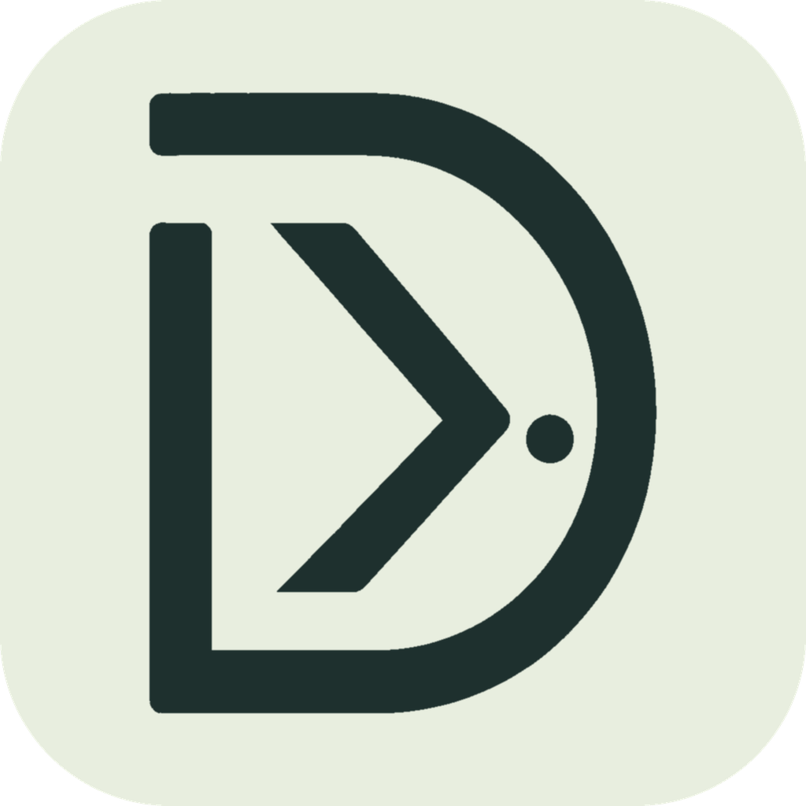

<div align="center">
  
  <h1>deskflow-ddc</h1>
  <p>One monitor. Two computers. One keyboard and mouse.</p>
  <p>Share input with Deskflow and switch monitor inputs with DDC/CI.</p>
  <p><a href="README.md">简体中文</a> · <strong>English</strong></p>
</div>

Deskflow DDC helps two computers share a monitor, keyboard and mouse. It bundles **Deskflow 1.27.0**, so no separate input-sharing engine installation is needed. Either computer can provide the physical keyboard and mouse; roles are independent of the operating system.

**Version 0.3.0** · [Downloads](https://github.com/Fantasy1316/deskflow-ddc/releases) · [Changelog, in Chinese](CHANGELOG.md) · [Report an issue](https://github.com/Fantasy1316/deskflow-ddc/issues)

This is an independent project, not affiliated with the [Deskflow](https://github.com/deskflow/deskflow) maintainers. The application uses Rust, Tauri 2 and Vue 3. The current application interface is in Chinese; this README provides English usage instructions.

## Features

- **Monitor and input switching:** coordinate both computers through a shortcut, dashboard button or tray menu.
- **Display-only mode:** switch inputs using local DDC commands, without a network, pairing or Deskflow process.
- **Manual monitor switching by default:** reaching an edge does not change the picture. Optionally enable automatic switching, or move input between separate displays while keeping the shared monitor unchanged.
- **Optional fallback without DDC:** experimental output control on macOS and Windows can trigger a monitor's automatic input selection.
- **Hostnames with IP fallback:** device discovery, fresh hostname resolution, backup IP addresses and previously authenticated addresses.
- **Modifier mapping and clipboard sharing:** optionally map Mac Command to Windows Ctrl, and configure clipboard sharing and size limits.
- **File and directory transfers:** encrypted direct transfers, large files, receiver approval, pause/resume, SHA-256 verification and name-conflict choices.
- **Launch at login and automatic sharing:** separate options, both disabled by default.
- **Status and recovery:** switching progress, source confirmation, tray reminders, output recovery and diagnostics from both computers.
- **Windows secure-desktop control:** an optional service for password/PIN entry after an already signed-in user locks Windows.

## Supported systems

| Platform | Requirements                                         | Packages / status                                           |
| -------- | ---------------------------------------------------- | ----------------------------------------------------------- |
| macOS    | Apple Silicon, macOS 14+                             | Application archive; Intel Mac DDC control is not supported |
| Windows  | Windows 10 / 11 x64, Microsoft Edge WebView2 Runtime | Installer; portable availability depends on the release     |
| Ubuntu   | Ubuntu 24.04, x86_64 / ARM64, X11                    | **Beta / experimental**, DEB packages                       |

Connect each computer to a different video input on the shared monitor. Full sharing requires network connectivity between the computers; display-only mode does not. Two computers running the same OS are also supported.

Ubuntu Beta does not support full sharing under Wayland/XWayland, secure-desktop control or the output-disconnection fallback. Application startup has been checked in an ARM64 virtual machine; actual input sharing, physical DDC and sleep recovery still require hardware validation. Ubuntu should not be treated as equally mature as macOS and Windows support.

## Check monitor compatibility first

DDC mode requires **DDC/CI** to be enabled and the monitor to support input switching through **VCP `0x60`**.

1. Enable DDC/CI in the monitor's physical menu. Its name and location vary by manufacturer.
2. On each computer, open the display settings page (**显示器与输入**), scan and select the shared monitor.
3. Stop sharing and use the standalone input test (**单独测试显示器切换**) to test switching away and back from both computers. Keep the monitor's physical input selector available.

**Detecting a monitor or reading its brightness does not establish input-switching support. Failure to read the current input does not establish that writes are unsupported.** Cables, docks and adapters can affect DDC. Some monitors accept commands only from the currently active video input, so test both directions.

If DDC cannot be used, try the experimental compatibility mode below. Monitors without suitable automatic input selection still require physical controls or a hardware switch.

## Installation and upgrades

1. Download the package for your system and architecture from [Releases](https://github.com/Fantasy1316/deskflow-ddc/releases). Use **0.3.0 on both computers** for full sharing.
2. Before upgrading, stop sharing and quit the old applications and any independent Deskflow instances on both computers. This application does not take over engines started by another application.
3. On macOS, extract and move `Deskflow DDC.app` to Applications, then open it and grant the requested Accessibility/Input Monitoring permissions. Permissions can be checked again from the application. Permission for the main application does not necessarily grant permission to the bundled engine.
4. On Windows, run the installer, or fully extract the portable package and open `Deskflow DDC.exe`. Keep its DLLs and `resources` directory together. Allow application network access through the firewall; install WebView2 Runtime if it is missing.
5. If Windows secure-desktop control is enabled, **install/update the background service** from Sharing Settings after upgrading.

Version 0.3.0 retains the 0.2-series configuration, device identity, pairing credentials and startup preferences. There is no need to delete configuration. Version 0.1 uses separate data; its device settings can be imported from Devices & Pairing (**设备与配对 → 导入旧版配置**), after which pairing and monitor mappings must be checked again.

The project currently does not provide Developer ID notarization or Windows publisher signing. Your OS may show an unknown-developer warning. Check the individual release and use packages from a trusted source.

## Quick start

### 1. Configure input values on both computers

Scan the shared monitor on each computer, enter the tested input values for the local and other computer, and save. For example, if A uses `3` and B uses `1`:

| Computer | Local input | Other computer's input |
| -------- | ----------- | ---------------------- |
| A        | 3           | 1                      |
| B        | 1           | 3                      |

These values are examples. **Do not infer them solely from HDMI, DP, DVI or VGA labels.** Monitor IDs can differ between the computers; scan and select locally on each side.

### 2. Choose roles and pair

1. In Devices & Pairing (**设备与配对**), choose “Connected to this computer” (**连接在这台电脑**) on the computer with the physical keyboard and mouse. This is the provider. Choose “Connected to the other computer” (**连接在另一台电脑**) on the receiver.
2. Initially show the provider's picture on the monitor. Click **开始等待连接** on the provider to wait for a connection.
3. On the receiver, use **查找设备** to find the provider, or enter its resolvable hostname/IP and an optional backup IP.
4. Save, paste the provider's complete pairing code and click **配对并开始共享**.
5. Wait for the engine to become ready, then test switching in both directions.

Pairing credentials are saved. On later starts, the receiver can leave the code blank. Changing devices, regenerating the code or importing old configuration requires pairing again.

### 3. Switch the picture and input

Default shortcuts are **`Ctrl + Option + F10` on macOS** and **`Ctrl + Alt + F10` on Windows**. Depending on Mac function-key settings, `Fn` may also be required. Stop sharing before changing the shortcut in Sharing Settings (**共享设置**).

DDC mode reads the current input after connecting and matches it against both configurations. If reading fails or results conflict, confirm the source according to the actual picture. **Source confirmation only updates the record; it does not switch the monitor or move input.** Input ownership does not prove which picture the monitor displays.

Repeated switching requests are blocked while a switch is running or the display is settling, preventing edge movement or repeated keystrokes from switching back and forth. A temporarily unavailable input readback does not, by itself, undo a completed input transfer. If the source becomes uncertain, check the picture and use a button with an explicit destination.

### Display-only mode

Choose **仅切换显示器** in the dashboard's operating-mode selector, save the local monitor and two different input values, then enable display switching (**启用显示器切换**). This mode does not move input or require the other computer to install or run the application.

All commands come from the local computer. Some monitors allow switching away but reject commands from an inactive input, preventing a switch back. Test both directions. Shortcut toggling considers current reads and recent commands so a stale read does not repeatedly select the same destination.

## Compatibility mode without DDC — experimental

This mode attempts to stop the original computer's video output so the monitor automatically selects the other computer. **It depends on the monitor's automatic input-selection behavior and is not a universal replacement for DDC.**

1. Enable automatic input selection in the monitor's physical menu.
2. Use full sharing on both computers. In the display settings' switching-method section (**显示器与输入 → 切屏方式**), select **断开输出，触发显示器自动选源**.
3. Scan and select the local shared output on each side, then save. Scanning and eligibility checks do not disable outputs.
4. Pair and connect, confirm which computer's picture is currently visible, then switch using a shortcut or button.

| Platform            | Requirements and limitations                                                                                                                                                                                                       |
| ------------------- | ---------------------------------------------------------------------------------------------------------------------------------------------------------------------------------------------------------------------------------- |
| Apple Silicon macOS | No BetterDisplay installation required. Keep the built-in display or another active display available. Mirrored outputs are unsupported. The system interface may be affected by macOS updates.                                    |
| Windows             | Requires exactly one active external output. Multiple outputs, mirroring and internal-display selections are unsupported. Physical input or another application may wake the output early; recovery timing depends on the devices. |
| Ubuntu              | Not supported.                                                                                                                                                                                                                     |

Switching proceeds in order: restore the destination output, transfer input, disable the original output, then acknowledge retention. It does not modify EDID. Completion records the requested destination but cannot directly verify the monitor's actual input. Confirm the source again after connection, reconnection or wake if it is unknown. Reaching a screen edge does not disable an output.

When the main window is hidden in the tray, an unknown source is presented in a native tray-adjacent popover. Losing focus does not close it. You can close or defer it manually; another unresolved switch attempt or return to the tray prompts again. The tray's **确认当前画面…** item also opens it.

A failed switch, stop, disconnection, wake or exit requests output restoration. A separate guardian also attempts recovery if the main application terminates unexpectedly. **If restoration fails, “Restore local display output” remains available in the main window and tray, even after stopping or disconnecting.** Using this action while sharing is running stops sharing first.

Test both directions and retain physical monitor controls, a local keyboard/mouse and the option to reconnect the video cable. Automatic selection and recovery depend on the specific GPU, monitor, cable, dock and driver.

## Screen edges, shortcuts and background operation

- **Screen edges:** arrange the computer tiles in the provider's Sharing Settings. The default keeps video switching manual. Optional modes follow input or move only input when the destination has a separate display. Select each computer's own independent/built-in display locally; do not mark the shared monitor as independent. If the selected display disappears during sleep or unplugging, the engine pauses and reconnection is retried when it returns.
- **Modifier mapping:** original mapping sends Command as Win and Control as Ctrl. The common-shortcuts option maps a Mac provider's Command to Windows Ctrl, or a Windows provider's Ctrl to Mac Command. Local input and same-OS sharing are unchanged. Shortcuts using different key combinations still follow the destination OS's conventions.
- **Launch at login:** start in the tray after the user reaches their desktop, not at the first pre-login screen. Put the application in a fixed location before enabling it.
- **Automatic sharing:** wait/connect using saved settings when the application starts, including waiting for an offline peer. Manual Stop prevents another automatic start during that run. In display-only mode, the option enables monitor control instead.
- **Tray and exit:** on macOS/Windows, left-click opens the main window and right-click opens switching, stopping, recovery and exit actions. Closing the window hides it in the tray; macOS also hides the Dock icon. Use Quit from the tray or Dock to exit completely. Without a working tray, closing the window exits.

## Files and directories

1. Pair, stay connected and open **文件传输**.
2. Drop files or whole directories onto the send area, or click it to select files. Multiple files are supported; archives are sent as ordinary files and are not extracted.
3. The receiver approves and chooses a destination. Items keep their original names, without an extra outer task directory. For conflicts, choose **Replace, Keep both or Stop**. Replacing a directory replaces it as a whole rather than merging it.
4. View progress/speed, pause, resume or cancel. After pausing or restarting, choose **重新发送此任务** on the original sender task, then **继续接收** on the receiver; source selection does not need to be repeated.

Transfers stream data rather than loading whole files into memory. A separate encrypted channel and SHA-256 verification are used. File sending backs off when control latency increases to reduce interference with shared input. Actual speed depends on Wi-Fi, disks, file counts and verification work.

- Files larger than 4 GiB are supported subject to the destination filesystem. Limits per batch are 100,000 files/directories, 64 directory levels and 256 root items; up to four tasks run concurrently.
- Incomplete data is stored under `.deskflow-ddc-TASK_ID.partial` in the destination. Do not move or modify it before completion. Canceling reception removes incomplete cache; removing a task record does not delete completed files.
- Symbolic links, junctions and special files are unsupported. Permissions, extended attributes and resource forks are not preserved; this is not a system-backup tool.
- System-level file copy/paste and dragging a file directly across screen boundaries are not provided.
- Stopping input sharing closes the control connection, but an established file transfer can continue. Pause/cancel file tasks separately. Switching to display-only mode pauses incomplete transfers.

## Windows lock screen and password entry

Ordinary sharing does not require administrator privileges but cannot control the password/PIN secure desktop. On the Windows receiver, stop sharing, open **共享设置 → 锁屏与登录界面控制**, install the background service and approve elevation. Enable **允许控制安全桌面**, save and restart sharing. This requires the bundled engine; update the service after updating the application.

Lock the Windows receiver through the dashboard/tray, or press **`Ctrl + Alt + Shift + L`** on the provider's keyboard while input is on Windows. On a Mac keyboard, Alt is Option. This sends an authenticated lock request rather than simulating `Win + L`.

The service does not store login passwords and manages only this application's engine. Support covers locking an already signed-in user, not initial boot login, login after sign-out or BitLocker. It does not simulate `Ctrl + Alt + Delete`. Remove the service before deleting a portable installation. Windows policies and security software can affect behavior.

## Ubuntu Beta

Use a DEB package marked `beta` for Ubuntu 24.04 x86_64 or ARM64.

```sh
sudo add-apt-repository -y universe
sudo apt update
sudo apt install ./YOUR_PACKAGE.deb
deskflow-ddc
```

Run as an ordinary user, not with `sudo`. Full sharing requires `echo "$XDG_SESSION_TYPE"` to return `x11`; otherwise sign out and choose **Ubuntu on Xorg** at login. GNOME needs the AppIndicator extension for tray support.

Pairing requires a default, unlocked system keyring. If startup reports a credential error, use **Passwords and Keys (seahorse)** to create a password-protected **Password Keyring**, set it as default, unlock it and reopen the application. Do not delete the configuration or identity file.

Physical DDC requires ddcutil and access to I²C devices. If the system has an `i2c` group, configure it as follows, then sign out/in before checking:

```sh
sudo modprobe i2c-dev
sudo usermod -aG i2c "$USER"
# After signing out and in:
ddcutil detect
ddcutil getvcp 60
```

If there is no `i2c` group, follow your distribution's device-access rules. The application does not elevate itself. Virtual machines usually do not pass through monitor DDC/I²C and cannot validate physical input switching. A keyboard/mouse-only mode without display configuration is not currently provided.

## Networking, privacy and reporting problems

- Full sharing needs direct connectivity between the computers; a local network is the usual setup. mDNS discovery normally works only within one subnet. Guest networks, client isolation, VPNs and firewalls can block discovery; enter a hostname and backup IP manually when needed.
- Default ports: control **TCP 49729**, input **TCP 24801**, discovery **UDP 5353**. File sending temporarily listens on an OS-assigned TCP port. Allow application network access; opening only fixed ports is insufficient for file transfers.
- Once dependencies are installed, sharing does not require the Internet or a cloud relay. Installing a missing WebView2 Runtime on Windows may require Internet access.
- Pairing keys use OS credential storage; engine private keys reside in the application's data directory. The application does not log keystroke contents, mouse trajectories or clipboard contents. Local file-task records retain names, paths and destinations for resuming transfers.
- Sharing is one-to-one. This application does not stream remote-desktop video, forward USB devices or wake computers automatically. Lock screens, sleep recovery, mixed DPI and monitor compatibility remain subject to OS, driver and engine limitations.

**If the mouse moves but clicks or keyboard input stop working**, stop sharing from a computer that remains usable. Closing the main window does not stop sharing. Engine shortcuts to return input to the provider are `Ctrl + Alt + Esc` for a Windows provider and `Ctrl + Command + Esc` for a Mac provider. They do not guarantee monitor recovery and can fail if the engine is unresponsive. The application's stop/recovery action is not guaranteed to remain reachable when all input is unavailable.

For bug reports, export diagnostics from **活动记录 → 导出诊断日志 on both computers**, and include application/OS versions, roles, cabling and reproduction steps. Logs contain device names, local addresses and file-task information; inspect before sharing. Never publish pairing codes, private keys or complete configuration files.

## License

Original project code is under the [MIT License](LICENSE). Bundled Deskflow and other components retain their own licenses; see [Third-party notices](THIRD_PARTY_NOTICES.md).

Thanks to [Deskflow](https://github.com/deskflow/deskflow), [m1ddc](https://github.com/waydabber/m1ddc), [Tauri](https://tauri.app/), [Vue](https://vuejs.org/) and [Lucide](https://lucide.dev/).
