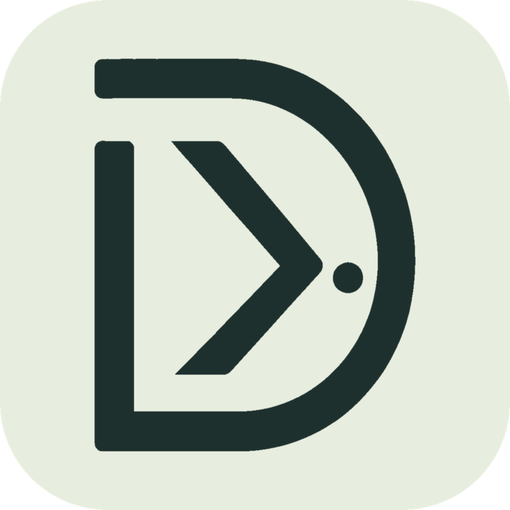

<div align="center">
  
  <h1>deskflow-ddc</h1>
  <p>一块显示器，两台电脑，一套键盘鼠标。</p>
  <p>使用 Deskflow 共享键鼠，使用 DDC/CI 切换显示器输入源。</p>
</div>

Deskflow DDC 是适合两台电脑共用一块显示器的桌面应用。使用 **Rust + Tauri 2 + Vue 3**，内置 **Deskflow 1.27.0**，无需另行安装键鼠共享引擎。实体键鼠可以连接在任意一端，按提供端和接收端配置，不绑定操作系统。

**0.2.3** · [下载安装包](https://github.com/Fantasy1316/deskflow-ddc/releases) · [更新说明](CHANGELOG.md) · [反馈问题](https://github.com/Fantasy1316/deskflow-ddc/issues)

这是独立项目，与 [Deskflow](https://github.com/deskflow/deskflow) 官方无隶属关系。

## 功能

- **画面与键鼠切换**：快捷键、应用按钮和托盘菜单协调键鼠与显示器输入源切换。
- **默认手动切换画面**：鼠标碰到边缘不切换输入源，避免日常操作误切屏；自动跟随模式可以主动开启。
- **屏幕布局与跨屏**：拖动电脑图块设置方向。目标有独立屏幕时可只转移键鼠，让共用显示器保持当前画面。
- **内置键鼠引擎**：随包提供固定版本的 Deskflow 及运行库，启动时使用隔离的配置和证书。
- **主机名连接与 IP 兜底**：支持 mDNS 发现、可解析主机名、手动备用 IP 和上次已认证地址。
- **跨系统修饰键映射**：可将 Mac Command 与 Windows Ctrl 对应，统一复制、粘贴等快捷键；仅影响远程接收端。
- **剪贴板共享**：可开关并设置容量；图片和富文本兼容性取决于 Deskflow 与两端系统。不提供文件传输或文件拖拽。
- **托盘与诊断日志**：后台共享、快速停止、导出两端日志。
- **退出保护**：退出时等待本应用的键鼠引擎结束；macOS 增加独立守护进程，在主应用异常结束后清理其所属引擎。

## 系统与硬件要求

| 项目    | 要求                                                               |
| ------- | ------------------------------------------------------------------ |
| macOS   | Apple Silicon，macOS 14 或更新版本；暂不支持 Intel Mac 的 DDC 控制 |
| Windows | Windows 10 / 11 x64，需要 Microsoft Edge WebView2 Runtime          |
| 显示器  | 开启 DDC/CI，并支持通过 VCP `0x60` 切换输入源                      |
| 接线    | 两台电脑分别连接共用显示器的不同输入接口                           |
| 网络    | 两台电脑之间网络互通，允许应用的控制与键鼠端口                     |

支持范围内的两台 Windows、两台 Mac 或 Windows / Mac 混合均按相同角色配置。显示器、扩展坞、转接器和线材会影响 DDC/CI；使用前请分别确认两端都能发送输入切换指令。

## 安装

1. 从 [Releases](https://github.com/Fantasy1316/deskflow-ddc/releases) 下载对应系统的版本，两端使用相同版本。
2. macOS 解压后打开 `Deskflow DDC.app`；Windows 使用安装程序，或完整解压便携包后运行 `Deskflow DDC.exe`。便携包内 DLL 和 `resources` 必须一起保留。
3. 开始共享前，停止旧版及独立 Deskflow 的共享，避免引擎和端口冲突。应用不会接管其他程序启动的引擎。
4. macOS 按系统提示授权辅助功能或输入监控；修改后可在应用中重新检测。主应用检测通过不代表内置 Deskflow 引擎也已获授权。
5. Windows 允许应用通过所用网络的防火墙；未安装 WebView2 时需先安装运行时。

项目当前默认构建不提供 Developer ID 公证或 Windows 发行签名，系统可能提示未知开发者。仅使用可信来源的包；具体签名情况以对应 Release 为准。

## 快速开始

### 配置显示器输入源

两端分别进入 **显示器与输入**，扫描并选择共用显示器，填写本机与另一台对应的输入源数值并保存。

例如，电脑 A 的输入源实测值为 `3`，电脑 B 为 `1`：

| 电脑 | 本机输入源 | 另一台输入源 |
| ---- | ---------- | ------------ |
| A    | 3          | 1            |
| B    | 1          | 3            |

以上只是示例，**请填写实际验证过的值**，不要仅凭 HDMI、DVI 或 VGA 名称推断。两端显示器 ID 可以不同，需各自扫描选择。

停止共享后，可使用“单独测试显示器切换”验证映射。测试会立即改变画面；必要时用显示器实体按键恢复。

### 选择角色并配对

1. 在 **设备与配对** 中，实体键鼠所在的电脑选择 **连接在这台电脑**，作为提供端；另一台选择 **连接在另一台电脑**，作为接收端。
2. 先让共用显示器显示提供端画面，提供端点击 **开始等待连接**。
3. 接收端点击 **查找设备** 选择提供端，也可填写提供端的可解析主机名或 IP，并配置备用 IP。
4. 保存设备设置，填写提供端配对码，点击 **配对并开始共享**。
5. 等待工作台显示引擎就绪，再尝试双向切换。

配对成功后会保存配对凭据。再次启动共享时，接收端可将配对码留空，点击 **开始共享**；重新生成配对码、导入旧版配置或更换配对设备后需重新配对。

默认控制端口为 **TCP `49729`**，键鼠端口为 **TCP `24801`**。mDNS 发现使用 **UDP `5353`**。

默认切换快捷键：macOS 为 **`Ctrl + Option + F10`**，Windows 为 **`Ctrl + Alt + F10`**。Mac 是否需要加 `Fn` 取决于功能键设置。Windows 的 `F12` 不适合作为全局切换键。停止共享后可在 **共享设置** 修改快捷键。

### 跨系统修饰键映射

停止共享，在键鼠提供端进入 **共享设置 → 跨系统修饰键映射**，选择模式、保存并重新开始共享。接收端自动使用提供端的设置。

- **保持原始按键（默认）**：跨系统时 Command 对应 Win，Control 对应 Ctrl。
- **统一常用快捷键**：Mac 提供键鼠时，Command 对应 Windows Ctrl、Control 对应 Win；Windows 提供键鼠时，Ctrl 对应 Mac Command、Win 对应 Control。例如使用 Mac 键盘控制 Windows 时，`Command + C / V` 可用于复制 / 粘贴。

映射仅在 Mac 与 Windows 之间转发输入时生效，同系统共享及本机操作保持原样。这会交换所有相关组合键；`Command + Tab` 与 `Alt + Tab` 等按键组合不同的操作仍需遵循目标系统规则。

### 配置鼠标跨屏

停止共享，在提供端进入 **共享设置 → 屏幕布局与鼠标跨屏**，拖动电脑图块设置相对方向。接收端连接后使用提供端布局。

- **画面仅手动切换（默认）**：边缘不切换输入源，只向有可见屏幕的电脑转移键鼠。两端都只有共用显示器时，通过快捷键或按钮切换。
- **跟随键鼠切换画面**：越过指定边缘时同时切换画面和键鼠。
- **目标有独立屏幕时仅转移键鼠，否则切换画面**：进入有独立屏幕的电脑时，共用显示器保持原输入。

有内置屏或另一块独立显示器的电脑，需要在本机设置中选择该屏幕；不要把共用显示器选为独立屏幕。例如共用显示器显示 Windows 时，Mac 已选择内置屏，就可以从 Windows 按布局滑回 Mac 内置屏，仅转移键鼠。

Windows 独立屏幕按显示设备接口标识保存，同一设备仅发生句柄或屏幕编号变化时可继续识别。旧版保存的数字句柄无法可靠迁移，请重新选择独立屏幕并保存；更换接口、扩展坞或重装驱动导致设备标识改变时，也需要重新选择。

共享期间，所选独立屏幕因睡眠或热插拔暂时消失时，应用会暂停键鼠引擎并保持等待，检测到屏幕恢复后自动重试连接。显式停止共享后不会自动开始；停止与重新开始会保留最近一次画面指令的目标，避免从错误的电脑发送 DDC 指令。

### 托盘与退出

左键单击托盘图标打开主界面；右键菜单提供 **打开主界面、切换到本机、切换到另一台、停止共享、退出**。

关闭窗口仅隐藏到托盘，后台共享继续；macOS 同时隐藏 Dock 图标，从托盘打开时恢复。要释放键鼠共享，选择 **停止共享**；要结束应用，选择 **退出**。若托盘创建失败，关闭窗口会走退出流程。

macOS 也支持从 Dock 右键选择 **退出**。应用会等待所属引擎停止后完成退出；系统注销或关机时使用同样的清理流程。主应用异常结束时，独立守护进程按进程身份清理所属引擎，不扫描或结束其他程序的引擎。这项保护不等同于键鼠无响应时的独立紧急停止功能。

页面不显示浏览器右键菜单。主机名、IP、已显示的配对码、错误信息与活动记录可选中复制；输入框保留系统复制、剪切与粘贴快捷键。

## 从旧版升级

0.2 与 0.1 使用独立配置、身份和凭据，不自动覆盖旧版数据。保留旧应用时应放在不同位置，并先停止旧版共享。

**设备与配对 → 导入旧版配置** 可以读取旧版 `settings.json`，导入前会备份当前配置。仅导入设备设置，不复制旧配对密钥与证书；导入后需要重新配对，并核对显示器、独立屏幕及快捷键。

0.2.3 沿用 0.2 系列的数据目录和凭据，从 0.2.0、0.2.1、0.2.2 或 0.2 预览版升级会保留配置和配对。两端必须同时升级到 0.2.3；对端版本不同或未提供版本号时，应用会阻止启动键鼠引擎。较早版本的跨屏模式会一次性设为默认手动画面模式，并保存原配置备份。

本次重新发布了 0.2.3。已安装此前 0.2.3 的用户也请重新下载两端安装包，先停止共享并退出旧版，再更新。

## 常见问题

**查找不到设备，或 IP 变动后无法连接**

mDNS 通常只在同一子网有效。跨子网、访客 Wi-Fi、客户端隔离或代理/VPN 路由可能阻止发现；TCP 可连接也不代表组播能到达。此时填写可解析的主机名与备用 IP，必要时设置路由器 DHCP 地址保留。

每次重连会重新解析主机名，随后尝试已配对设备的发现地址、手动备用 IP、上次已认证地址。所有候选地址都必须通过身份校验；旧 IP 无法保证在设备地址变化后仍可用。

**一直显示“引擎连接中”**

检查两端版本、端口、防火墙与系统权限，并退出独立 Deskflow。控制连接建立不代表键鼠引擎已就绪。0.2.3 会阻止与版本不同或未提供版本号的旧端启动键鼠引擎，请同时更新两端。

**输入源写入失败，或提示画面状态不确定**

检查 DDC/CI、当前输入、线材和扩展坞。部分显示器只接受活动输入端的 DDC 指令。指令发送成功也不能证明物理画面已经切换。状态不确定后请停止共享，使用实体按键恢复提供端画面，再重新连接。

**鼠标能动，但无法点击或键盘无响应**

当前存在输入捕获后无法操作的报告，原因尚未确定。有另一台可操作的电脑时，优先在那一端选择 **停止共享**。关闭主窗口不会停止共享。

引擎内置的返回提供端按键为 Windows `Ctrl + Alt + Esc`、Mac 提供端 `Ctrl + Command + Esc`，只请求转移键鼠，不保证恢复显示器输入；引擎失去响应时该按键也可能失效。Windows 可尝试 `Ctrl + Alt + Delete` 进入安全界面；仍无法操作时需要通过可用的本机或远程管理手段结束对应引擎。项目尚未提供独立于引擎的紧急停止机制。

**如何反馈问题**

在两端分别进入 **活动记录 → 导出诊断日志**，附上系统版本、应用版本、接线方式、角色和复现步骤。日志包含设备名、局域网地址和配置摘要，分享前请检查。不要公开配对码、私钥或完整配置文件。

## 隐私与限制

- 应用直接连接另一台电脑，键鼠和剪贴板由 Deskflow 传输，不提供云中转。
- 配对密钥使用 macOS 钥匙串或 Windows 凭据管理器；引擎私钥存放在应用数据目录。
- 本应用不记录按键内容、鼠标轨迹或剪贴板内容；诊断日志会过滤配对码等敏感信息。
- 当前支持一对一共享，不提供远程桌面视频、USB 转发、自动唤醒或文件传输。
- 锁屏、UAC 安全桌面、睡眠恢复及不同 DPI 的跨屏行为受操作系统和引擎限制。

## 从源码构建

需要 Node.js 22.13+、pnpm 11、Rust 1.90+ 和目标系统的 Tauri 构建环境。macOS 使用 Apple Silicon 与 Xcode Command Line Tools；Windows 使用 Visual Studio C++ Build Tools 和 Windows SDK。

```sh
pnpm install --frozen-lockfile
pnpm prepare:engine
pnpm pack:mac  # 在 macOS 上构建 .app
# pnpm pack:win  # 在 Windows 上构建安装包
```

首次准备引擎需联网下载并校验官方资源。产物位于 `src-tauri/target/release/bundle/`，需完整分发内置运行库、源码及许可材料。

## 许可证

项目原创代码使用 [MIT License](LICENSE)。内置 Deskflow 及其他第三方组件保留各自许可证，详见 [第三方声明](THIRD_PARTY_NOTICES.md)。

感谢 [Deskflow](https://github.com/deskflow/deskflow)、[m1ddc](https://github.com/waydabber/m1ddc)、[Tauri](https://tauri.app/)、[Vue](https://vuejs.org/) 和 [Lucide](https://lucide.dev/)。
